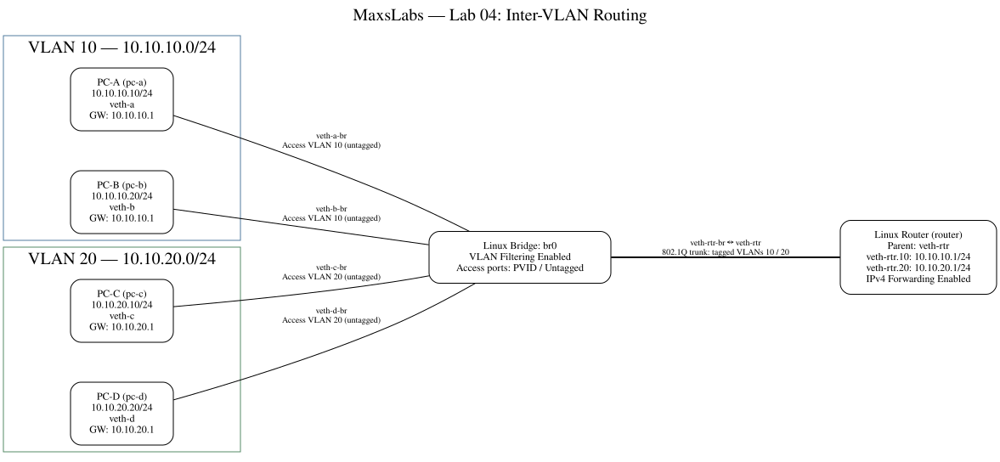

# Lab 04 — Inter-VLAN Routing

## Overview

This lab extends Lab 03's VLAN segmentation with router-on-a-stick routing. Four Linux network namespaces connect to a VLAN-aware bridge, while a fifth namespace routes between VLAN 10 and VLAN 20 over one tagged trunk.

I built the environment manually, inspected traffic using `tcpdump`, deliberately broke routing by disabling IPv4 forwarding, and automated the rebuild and cleanup using Bash scripts.



## Objectives

- Configure access ports and an 802.1Q trunk on a Linux bridge.
- Create router VLAN subinterfaces and endpoint default gateways.
- Route traffic between separate VLAN broadcast domains.
- Compare tagged trunk traffic with untagged access-port traffic.
- Inspect routes and neighbour resolution.
- Diagnose disabled IPv4 forwarding and setup-script errors.
- Rebuild the environment using setup and cleanup scripts.

## Topology and Addressing

| Namespace | Interface | IPv4 Address | VLAN | Default Gateway |
|---|---|---|---|---|
| pc-a (PC-A) | `veth-a` | `10.10.10.10/24` | 10 | `10.10.10.1` |
| pc-b (PC-B) | `veth-b` | `10.10.10.20/24` | 10 | `10.10.10.1` |
| pc-c (PC-C) | `veth-c` | `10.10.20.10/24` | 20 | `10.10.20.1` |
| pc-d (PC-D) | `veth-d` | `10.10.20.20/24` | 20 | `10.10.20.1` |
| router | `veth-rtr.10` | `10.10.10.1/24` | 10 | — |
| router | `veth-rtr.20` | `10.10.20.1/24` | 20 | — |

The bridge `br0` has VLAN filtering enabled. Its access ports are `veth-a-br` and `veth-b-br` (VLAN 10), and `veth-c-br` and `veth-d-br` (VLAN 20). Each access port uses its VLAN as the PVID and transmits untagged frames.

The bridge port `veth-rtr-br` carries tagged VLANs 10 and 20 to `veth-rtr` inside the router namespace. The router's parent interface has no IPv4 address; its VLAN subinterfaces provide the gateways. Default VLAN 1 membership is removed from all five bridge ports by the setup script.

## Routing and Packet Flow

For PC-A to reach PC-C:

1. PC-A identifies `10.10.20.10` as outside its `/24` and sends traffic to gateway `10.10.10.1`.
2. PC-A resolves the gateway's MAC address using ARP and sends an untagged frame through its access port.
3. The bridge classifies the frame into VLAN 10 and sends it tagged on the router trunk.
4. The router receives the packet through `veth-rtr.10`, consults its directly connected route to `10.10.20.0/24`, and forwards through `veth-rtr.20` with IPv4 forwarding enabled.
5. The routed packet returns over the trunk in a new Ethernet frame tagged VLAN 20. The bridge removes the tag when transmitting through PC-C's access port.
6. PC-C sends its reply through gateway `10.10.20.1` along the reverse path.

The end-to-end IPv4 addresses remain unchanged. The router decrements TTL and creates a new Ethernet frame for the destination VLAN. No NAT is required. Routing allows selected Layer 3 communication while the VLANs remain separate Layer 2 broadcast domains.

The router needs only its two connected routes for this topology. PC-A's neighbour table resolves the local gateway for remote traffic, rather than PC-C directly. See [routing and neighbour notes](evidence/routing-and-neighbours.md).

## Packet Analysis

I observed the same ICMP packet arriving on the router trunk tagged VLAN 10 and returning tagged VLAN 20 after routing. On the access side, I captured untagged IPv4 frames on `veth-c-br`.

The [packet-capture documentation](captures/README.md) explains the capture points, matching fields, and commands for collecting text or PCAP evidence. I have documented these observations in my session notes. The original tcpdump transcripts and PCAP files are not included in this repository.

## Troubleshooting

I disabled `net.ipv4.ip_forward` inside the router and confirmed that inter-VLAN traffic failed despite connected routes being present. I restored it to `1` and verified that routing worked again.

During automation, missing `veth` arguments on the PC-C and PC-D link-creation lines stopped setup. I corrected the script and rebuilt successfully. My setup script includes those fixes.

See [troubleshooting notes](troubleshooting.md) for symptoms, investigation, fixes, and VLAN-filtering checks.

## Validation and Evidence

After the automated rebuild, I ran:

```bash
sudo ip netns exec pc-a ping -c 2 10.10.20.10
```

I received **2 replies from 2 packets transmitted, with 0% packet loss** and reply TTL `63`. This is consistent with a single router hop from an initial TTL of 64.

- [Recorded connectivity output](evidence/connectivity-test.txt)
- [Evidence provenance and validation summary](evidence/README.md)
- [Routing and neighbour notes](evidence/routing-and-neighbours.md)
- [Packet-capture documentation](captures/README.md)

I validated the cleanup/setup rebuild by testing PC-A to PC-C connectivity. This recorded test covers that path; it does not establish an exhaustive test of every endpoint pair.

## Automation

Requirements: Linux with network namespaces, VLAN and bridge support, Bash, `iproute2` (including `/usr/sbin/bridge`), `ping`, and `tcpdump` for packet analysis. Graphviz is needed only to render the diagrams.

Run from this lab directory on a dedicated lab host:

```bash
sudo ./scripts/setup.sh
sudo ip netns exec pc-a ping -c 2 10.10.20.10
```

Remove the environment with:

```bash
sudo ./scripts/cleanup.sh
```

Setup expects the lab namespace and interface names to be unused. If rebuilding this lab, run cleanup first. The names overlap earlier labs; cleanup deletes the named namespaces and `br0`, so do not run overlapping labs simultaneously.

My [setup script](scripts/setup.sh) and [cleanup script](scripts/cleanup.sh) reproduce and remove the completed lab.

## Diagram Source

The Graphviz [source](diagrams/topology.dot), [SVG](diagrams/topology.svg), and [PNG](diagrams/topology.png) follow the earlier labs' format. Regenerate from this lab directory:

```bash
dot -Tsvg diagrams/topology.dot -o diagrams/topology.svg
dot -Tpng diagrams/topology.dot -o diagrams/topology.png
```

## Key Findings

A VLAN-aware bridge separates broadcast domains; a router provides communication between their IP networks. Access ports carry untagged endpoint traffic, while a shared trunk distinguishes the VLANs using 802.1Q tags. Correct VLAN membership, default gateways, connected routes, and IPv4 forwarding are all necessary for this routed path.
