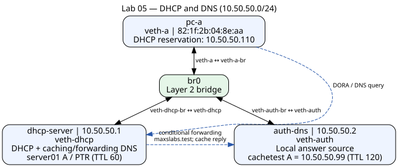

# Lab 05 — DHCP and DNS infrastructure

This isolated Linux namespace lab demonstrates DHCP address assignment, a MAC reservation, forward/reverse DNS, conditional forwarding, and DNS caching. Existing evidence contains actual captured results; setup never rewrites it.



| Component | Interface | Address / role |
|---|---|---|
| pc-a | veth-a ↔ veth-a-br | MAC 82:1f:2b:04:8e:aa; DHCP reservation 10.50.50.110/24 |
| dhcp-server | veth-dhcp ↔ veth-dhcp-br | 10.50.50.1/24; DHCP and caching DNS resolver |
| auth-dns | veth-auth ↔ veth-auth-br | 10.50.50.2/24; local DNS answer source |
| br0 | All three bridge-side peers | Layer 2 switching; no host IP assigned |

## Reproduce

Requirements: Linux with root/network namespace support, iproute2, dnsmasq at `/usr/sbin/dnsmasq`, ISC dhclient, util-linux (flock), coreutils (timeout), and dig for verification. Run on a lab machine with these exact namespace/link names reserved for this exercise.

From this directory:

```bash
sudo ./scripts/setup.sh
sudo ip netns exec pc-a dig @10.50.50.1 server01.maxslabs.test
sudo ip netns exec pc-a dig @10.50.50.1 -x 10.50.50.1
sudo ip netns exec pc-a dig @10.50.50.1 cachetest.maxslabs.test
sleep 10
sudo ip netns exec pc-a dig @10.50.50.1 cachetest.maxslabs.test
sudo ./scripts/cleanup.sh
```

Setup refuses existing unmanaged resources. If continuing the manually built lab, preserve captures first and explicitly run cleanup before setup. Repeating setup with a managed runtime does not rebuild it; use cleanup then setup for a fresh configuration. Cleanup can be repeated and removes all processes in the three named lab namespaces, including processes launched manually. Do not put unrelated processes there.

Server PIDs, logs and leases live in `/run/networkplus-lab05`. The DHCP client uses `/run/dhclient-lab05.pid` and `/run/dhclient-lab05.leases`, matching the installed AppArmor profile. Its custom hook is mounted over the standard hook path inside a private mount namespace; the host copy stays unchanged. Cleanup retains logs/leases for inspection; `/run` is temporary across reboots. Setup uses a namespace-local DHCP hook, so it does not modify host DNS settings. Queries use explicit `dig @10.50.50.1`. The gateway is delivered by DHCP as 10.50.50.1, but this lab does not configure Internet routing/NAT. A default route alone does not prove external connectivity.

## DHCP: DORA, leases and reservation

Discover broadcasts a client request; Offer proposes an address; Request selects it; Acknowledge confirms the lease and options (UDP client 68/server 67). The pool is 10.50.50.100–10.50.50.150 with a one-hour lease. The resolver config reserves 10.50.50.110 for MAC 82:1f:2b:04:8e:aa; setup sets that MAC before requesting DHCP.

`evidence/pc-a-address.txt`, `pc-a-routes.txt`, and `dhcp-leases.txt` record the assigned address, gateway and matching lease/MAC. The lease file's first field is an expiry timestamp, followed by MAC, IP, hostname and client identifier. These files establish the resulting lease; a DORA packet trace is a separate exercise:

```bash
sudo ip netns exec dhcp-server tcpdump -ni veth-dhcp 'udp port 67 or udp port 68'
```

Start capture before renewal/reacquisition. Save new captures under a new filename; never replace original evidence.

## DNS records and resolver flow

`configs/dnsmasq-resolver.conf` serves `server01.maxslabs.test → 10.50.50.1` locally (A), and `10.50.50.1 → server01.maxslabs.test` (PTR), with a 60-second local TTL. Both are verified in the corresponding evidence files.

For `cachetest.maxslabs.test`, pc-a queries the resolver at 10.50.50.1, which conditionally forwards the maxslabs.test suffix to 10.50.50.2. `configs/dnsmasq-authoritative.conf` supplies 10.50.50.99 with TTL 120. This is a record value, not a fourth configured lab host.

The second component is called “authoritative” in the lab filenames because it owns the local answer. The captured configuration uses local/address directives, not dnsmasq `auth-server`/`auth-zone` formal authoritative-zone mode. The resolver performs forwarding and caches replies; this exercise does not demonstrate iterative root-to-TLD recursion. Its captured config may inherit host upstream resolvers for other domains, which this isolated topology cannot necessarily reach.

## TTL caching evidence

`dns-cache-first-query.txt` shows TTL **120** at 22:00:12 (+04); `dns-cache-second-query.txt` shows **107** at 22:00:25. The elapsed 13 seconds matches the TTL decrease, demonstrating a cached answer. The second response also lacks the first response's AA flag. TTL bounds cache lifetime; after expiry the resolver queries upstream again. A new run may begin with a warm cache, so restart the lab before a controlled first-query test. Resolver query logs can corroborate whether a query was forwarded or served from cache.

## Break/fix

See [troubleshooting.md](troubleshooting.md) for controlled link, DHCP, forwarding and cache tests. Keep new observations separate from the original evidence.

## Files

- `scripts/setup.sh`, `scripts/cleanup.sh`: reproducible lifecycle and bounded process shutdown.
- `configs/`: original captured dnsmasq configurations.
- `evidence/`: original lease, addressing, route and DNS observations.
- `topology.dot`, `topology.svg`: diagram source and rendered view.

Shell syntax and both dnsmasq configuration syntax checks passed. The corrected cleanup/setup scripts were run successfully on the lab host: PC-A acquired the reserved 10.50.50.110/24 address and default route via 10.50.50.1. [Rebuild evidence](evidence/script-rebuild.txt) preserves the user-supplied terminal output. After the scripted rebuild, DNS verification also passed: server01 A returned 10.50.50.1, its PTR returned server01.maxslabs.test, and cachetest returned 10.50.50.99 with TTL decreasing from 120 to 110 seconds over a ten-second interval. [DNS verification evidence](evidence/script-dns-verification.txt) preserves these user-supplied results alongside the original evidence.
